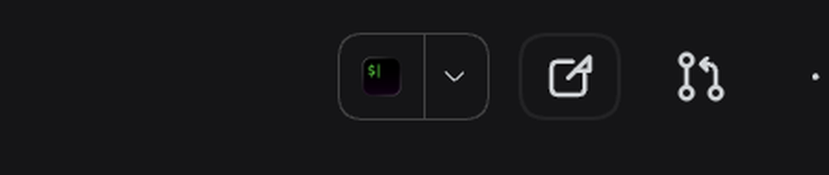

# dsh-open-in-qoder

在 DSH 会话头部加一个按钮：把当前会话的 workspace 目录直接交给本机的 **Qoder CN IDE** 打开。



## 为什么需要它

DSH 自带的「Open In...」分体按钮挂的是 `@deepseek-ai/dsh-host-open-in-app`，它的应用目录是**编译期写死的白名单**（Cursor / VS Code / Xcode / JetBrains 全家桶 / Ghostty / Warp / iTerm2 …）。官方文档的原话是：

> 目录在构建期固定。部署无法从 `cordis.yml` 增加自己的编辑器或 Git GUI；扩展列表意味着同时扩展 `OPEN_IN_APP_CATALOG` 与浏览器包的词典。

macOS 上它只会在 `/Applications` 和 `~/Applications` 里按已知 bundle 名做探测，所以 Qoder CN IDE（以及 Antigravity、HBuilderX 这类不在名单里的 IDE）永远不会出现，改配置也没用——它不是枚举系统里装了什么。

这个插件用「一个本地插件」的正规方式补上这一格：**不 fork、不 patch 官方包**，而是自己注册一个 Host 路由 + 一个浏览器槽位，所以在 DSH 升级后依然有效。

## 安装

DSH 插件管理里以本目录为 target 安装（`install_bundle`），或者手工在 profile 的 `package.json` 里加一条 `link:` 依赖并把 `dsh-open-in-qoder` 加进 `dsh.profile.bundles`。安装后**重启 DSH**，刷新页面，会话头部就会多一个按钮。

- 按钮出现在「Open In...」分体按钮右边（`order: -9`，紧跟官方的 `-10`）。
- 它只在这台机器确实装了这个 IDE 时才渲染；没装就整块消失，不留死按钮。
- 安装新版本的 IDE 后需要重启 DSH 才认得到（解析每个宿主进程只做一次，和官方目录同一条规则）。

## 配置

行 id 是 `qoder-open`，包名 `dsh-open-in-qoder`。需要在 `cordis.patch.yml` 里覆盖时：

```yaml
- id: qoder-open
  name: dsh-open-in-qoder
  config:
    appName: Qoder CN IDE
    label: Qoder CN IDE
    cliRelativePath: Contents/Resources/app/bin/qodercn
    useCli: true
    launchWatchMs: 1200
```

| 字段 | 默认值 | 含义 |
|---|---|---|
| `appName` | `Qoder CN IDE` | `/Applications`、`~/Applications` 下要探测的 bundle 名，`.app` 后缀可写可不写。 |
| `appPath` | 空 | 直接指定 `.app` 的绝对路径（装了多个副本、或放在别处时用）。设了它就不再看 `appName`。 |
| `label` | `Qoder CN IDE` | 按钮 tooltip 与提示里的显示名。 |
| `cliRelativePath` | `Contents/Resources/app/bin/qodercn` | bundle 内的 CLI，相对 `.app` 根目录。 |
| `useCli` | `true` | 是否优先用内置 CLI 打开目录；关掉就退回 `open -a <bundle> <dir>`。 |
| `launchWatchMs` | `1200` | 启动早失败的看护窗口：窗口内启动器就以非零退出，才算失败。 |

想换成别的 VS Code 系 IDE（Cursor 变种、Trae、Antigravity…），只改 `appName`/`label` 即可；非 VS Code 系的应用大概率没有这个 CLI，把 `useCli: false` 让它走 `open -a`。

## 工作方式

Host 半边（`index.js`）注册两条路由，都先过 DSH 自己的浏览器认证栅栏（`connection.requestRejection`，没有 `connection` 服务时直接 403，不降级成更弱的 Host/Origin 判断）：

- `GET /open-in-qoder/status` → `{ ok, value: { available, label, appPath, launcher } }`
- `POST /open-in-qoder/open` → 体 `{ "path": "/绝对/目录" }`，路径必须是当前存在的绝对目录，否则 400

启动顺序：能用 bundle 内的 CLI 就用它（`qodercn <dir>`，语义最准），否则 `open -a "Qoder CN IDE" <dir>`（该 bundle 声明了 `public.folder` 文档类型，接受目录）。子进程 detached 派生、不继承本进程的 `*KEY*` / `*SECRET*` / `*TOKEN*` / `*PASSWORD*` / `*AUTH*` 之类的环境变量。

浏览器半边（`client.js`）通过 `ctx.slots.register` 挂进 `conversation.session.header.utilities`，从 slot props 的 `useSessions` 读当前会话的 `cwd`，点击后 POST 给 Host。成功时桌面端不弹提示（IDE 窗口本身就是反馈），触屏设备才提示「已在 … 中打开」；失败一律弹一条 3.6 秒的 toast。

## 验证

在 macOS（DSH `0.2.2-rc.1` + Qoder CN IDE 1.39.2）上实测：按钮出现在会话头部「Open In...」右侧；点击后 Qoder CN IDE 以当前会话的 workspace 目录打开了窗口标题为 `<文件> — <目录名>` 的工程。Host 路由用 curl 直连返回 `{"ok":true,"value":{"available":true,"label":"Qoder CN IDE","launcher":"cli"}}`。

## 已知限制

- **只在 macOS 上验证过。** Host 的探测路径写的是 `/Applications` 与 `~/Applications`；Linux/Windows 需要自己用 `appPath` 指过去，或用 `useCli: false` 交给系统打开器。
- **可用性按进程缓存。** 装/卸 IDE 后要重启 DSH；页面侧每次加载读一次。
- **不合并进官方下拉菜单。** 官方菜单项由 `dsh-host-open-in-app` 的编译期目录渲染，第三方插件无法往里塞条目（那需要改 DSH 源码），所以这里是同一排里的独立按钮。
- **图标是原创的通用「代码 + 外开」标记**，没有使用 Qoder 的商标素材。

## 开发

```bash
npm run check   # node --check 两个入口
npm test        # 不依赖 DSH 的 smoke test：假 Cordis 上下文 + 假 HTTP 对象 + 假 .app
```

`test/smoke.mjs` 会真的 `apply()` 一次、真的走路由 handler，覆盖：路由注册与释放、bundle 解析、缺失应用、认证栅栏（401/403/无 connection）、启动成功、方法/媒体类型/体积/路径校验、配置覆盖。

## License

MIT © 2026 yinshipeng